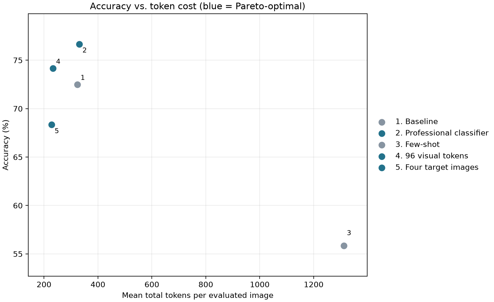

# 用 Qwen3-VL 做鸟类图像分类

这是一个课程实验，用 Qwen3-VL-2B-Instruct 做 20 类鸟的图像分类。我先跑了单图零样本基线，再比较角色提示、三张 few-shot 示例、降低输入分辨率和一次分类四张图，看看准确率和 token 开销怎么变。

- **官方测试集（184 张）**：基础组答对 133 张（72.28%），验证集入选的 Roleplay 答对 137 张（74.46%）。
- **验证集（120 张）**：96 视觉 token 档答对 89 张，比正常单图多 2 张，平均每图总 token 少 28.0%。

[验证集对照表](results/validation_comparison.csv) · [官方测试集对照表](results/test_comparison.csv) · [实验总结](实验总结.md)



## 怎么跑

在项目根目录操作。我当时用的是 Linux、Python 3.12.4 和一张 A800，模型按 BF16 加载。下面是 CUDA 12.6 的安装例子，其他环境按设备选择对应的 PyTorch 构建。[PyTorch 安装说明](https://pytorch.org/get-started/previous-versions/#v280)

```bash
conda create -n qwen-birds python=3.12.4 pip -y
conda activate qwen-birds
python -m pip install torch==2.8.0 torchvision==0.23.0 \
  --index-url https://download.pytorch.org/whl/cu126
python -m pip install -r requirements.txt
```

从 Hugging Face 下载我用的两个修订。模型目录需包含权重和处理器文件，数据目录保留 `train/<类别>/` 和 `test/<类别>/` 的结构。[Qwen 官方模型](https://huggingface.co/Qwen/Qwen3-VL-2B-Instruct) · [课程数据集](https://huggingface.co/datasets/raoyongming/simple_classification)

```bash
hf download Qwen/Qwen3-VL-2B-Instruct \
  --revision 89644892e4d85e24eaac8bacfd4f463576704203 \
  --local-dir models/Qwen3-VL-2B-Instruct
hf download raoyongming/simple_classification --repo-type dataset \
  --revision 95540ab52418c6bbdac1fa882d299c19f6c82ad1 \
  --local-dir data/simple_classification
```

先生成基础组的测试结果，再跑进阶。进阶用固定的 120 张验证图选方案，复用基础组的测试记录，只补跑入选的非基线方案。下面的 `0.25` 是我在 A800 上的 PyTorch 显存分配上限，可按自己的显卡调节。重复运行时使用新的输出目录。

```bash
python scripts/run_baseline.py --gpu-memory-fraction 0.25 \
  --output-dir outputs/baseline
python scripts/run_advanced.py --gpu-memory-fraction 0.25 \
  --baseline-dir outputs/baseline --output-dir outputs/advanced
```

`scripts/` 放推理和评测代码，`results/` 放本次实验的三个精选结果。`outputs/` 会在运行时生成完整预测、日志和图表。
